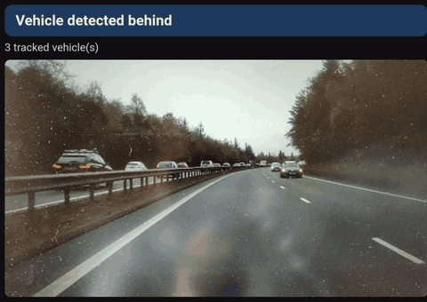
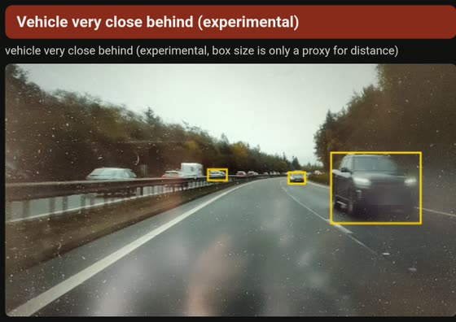
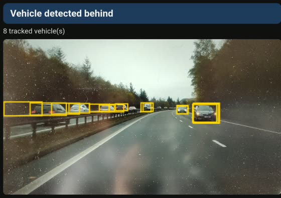
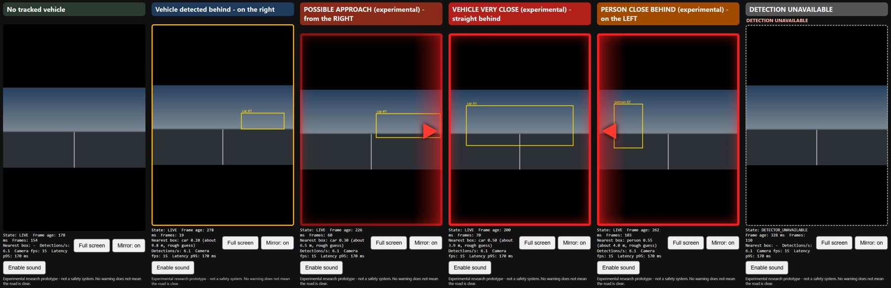
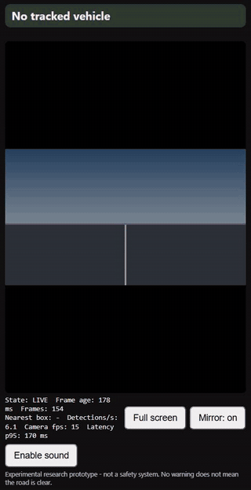
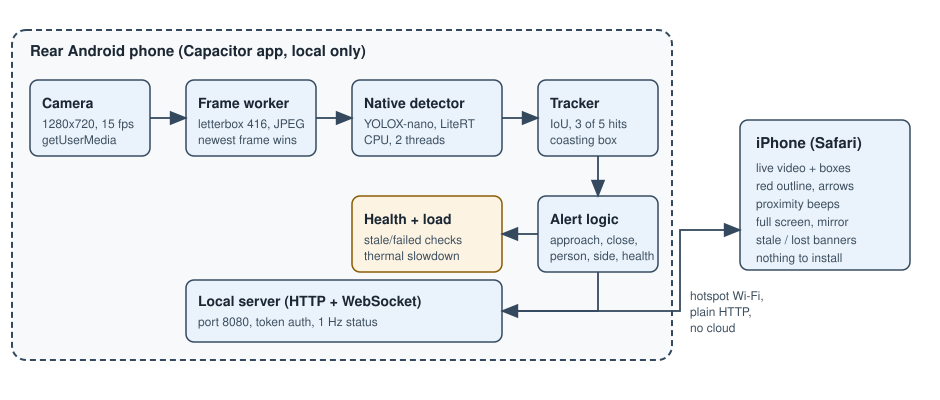

# Smart Rear-View Assistant (driver-assistance)

An **experimental, privacy-first** rear-view assistant built from two phones:

- an old **Android phone** mounted in the rear window: captures video, runs a lightweight vehicle detector locally, tracks vehicles, and serves a local stream;
- an **iPhone** acting as the viewer in Safari (nothing to install) over a local Wi-Fi hotspot.

> **Not a safety system.** This is a research prototype. It is not certified, not validated, and must not be relied on for driving decisions. The absence of a warning never means the road is clear.

## Status

**Working prototype, debug builds only.** Camera, on-device detection (people and four vehicle classes), tracking, alerts (including "possible approach", "vehicle very close", "person close behind" and "detection unavailable"), a local viewer server, a Safari viewer with proximity beeps, left/right direction, full-screen mode and QR pairing all exist and are tested on one OnePlus 6T and one iPhone. Not validated against labelled footage, not field-tested in traffic, thermal behaviour needs cooling. See `docs/OPEN_SOURCE_POST.md` for the plain-language summary with measurements, `docs/SESSION_HANDOFF.md` for the exact verified state, and `docs/TESTING_AND_VALIDATION.md` for every result.

Run the tests: `cd app && npm install && npm test`. Build a debug APK: `tools/device/build-debug.ps1` (Windows, Android SDK and JDK required).

## What it looks like

### A real run



*Real recording of the rear phone's own screen (OnePlus 6T, v0.5.0): the phone filmed a laptop screen playing a motorway dashcam video. Boxes, the status headline and the alert colour are what the app drew, at about 7 detections per second with a frame-to-result latency of about 0.14 s. The clip shows a car passing close on the right turning the headline red ("Vehicle very close behind"). In this recording the boxes on the rear phone's preview blink on and off: that was a drawing bug in v0.5.0 (each new preview frame wiped the boxes), fixed in v0.5.1; the viewer on the iPhone was not affected. The video was filmed facing forward, so "behind" just means "in the camera's view".*

| A vehicle very close | Several vehicles tracked |
| --- | --- |
|  |  |

**Look closely: it misses things.** In the recording, plenty of clearly visible cars far down the road have no box in many frames, and tiny distant boxes come and go. That is what a small model on an old phone does, and it is why this is not a safety system. The footage is a third-party dashcam video, published here with the maintainer's confirmation; if you hold the rights and object, open an issue and it will be removed. Number plates are not legible at this size and one is blurred. In a second, hand-held test the "person close" alert also fired on a hand held in front of the lens: false alarms exist too.

### The viewer's alert states (scripted demo data)



*The real viewer page rendered with **scripted demo data** (a plain synthetic backdrop and made-up detections), not a real drive: no tracked vehicle, vehicle nearby, possible approach, vehicle very close, person close, detection unavailable. Mirror is on, so an approach from the left of the camera picture reads "from the RIGHT" like a rear-view mirror.*



*The same six states as an animation (scripted, about two seconds each).*



If you run it on your own footage, please share screenshots or a clip in an issue.

## Install

Full guide: **[docs/INSTALL.md](docs/INSTALL.md)**. The easiest way is the signed experimental pre-release APK on the [Releases page](https://github.com/Shreyas9400/rear-view/releases) (sideload it on the rear Android phone). Or build and sideload a debug APK yourself:

```bash
cd app && npm install && npm run build && npx cap sync android
cd android && ./gradlew assembleDebug      # Windows: gradlew.bat assembleDebug
adb install -r app/build/outputs/apk/debug/app-debug.apk   # path relative to app/android
```
Open the app on the rear phone, allow the camera, turn on its hotspot, join your iPhone to it, scan the QR code once in Safari, and bookmark the address.

## Key properties

- Local-first: detection on-device, no cloud, no video upload, no recording by default.
- Local network only (hotspot, no internet needed). Plain HTTP with token auth — see `docs/SECURITY_AND_PRIVACY.md` for the limits.
- Experimental approach indication from bounding-box growth, plus proximity alerts from box size. Distance is an approximate estimate you can calibrate, not a measurement. Gyro/accelerometer are not used yet.

## Licence

Apache License 2.0: see `LICENSE`. Third-party components and the bundled detector model keep their own licences: see `NOTICE`.

## Documentation map

| Document | Purpose |
| --- | --- |
| `CLAUDE.md` | Permanent rules for every Claude session |
| `docs/SESSION_HANDOFF.md` | Current verified state and next tasks (read first) |
| `docs/ARCHITECTURE.md` | System design, components, data flow, constraints |
| `docs/IMPLEMENTATION_PLAN.md` | Milestones, gates G0–G4, fallbacks |
| `docs/TECHNICAL_DECISIONS.md` | Decision register |
| `docs/PROTOCOL_SPEC.md` | HTTP/WebSocket contracts |
| `docs/TESTING_AND_VALIDATION.md` | Test plan, acceptance criteria, results table |
| `docs/SECURITY_AND_PRIVACY.md` | Threat model, privacy, retention |
| `docs/DEVICE_COMPATIBILITY.md` | What to discover on the real phone; compatibility matrix |
| `docs/TROUBLESHOOTING.md` | Failure diagnosis |
| `docs/ACCOUNT_MIGRATION.md` | Continuing from another Claude account or machine |
| `docs/INSTALL.md` | Build, install, connect, calibrate, troubleshoot |
| `docs/OPEN_SOURCE_POST.md` | Plain-language project summary and announcement text |

## Development

Development is incremental across Claude sessions. Start with `CLAUDE.md`. Do not begin implementation until the Phase 0 documentation has been reviewed and approved.
