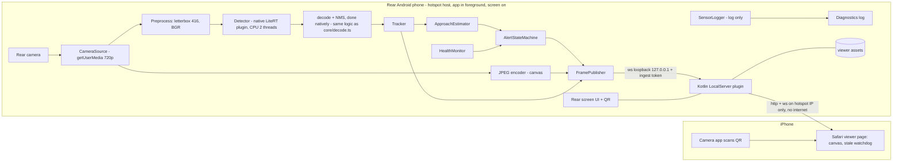
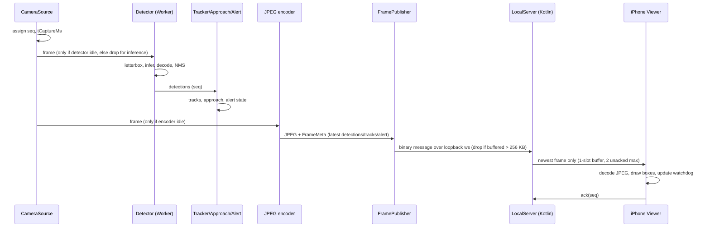

# ARCHITECTURE

Status: **intended design, nothing implemented.** Last updated 2026-10-22 (Phase 0). Evidence labels: **[V]** verified from a cited source, **[A]** engineering assumption, **[Q]** unresolved. Source of truth for actual state is the code and executed tests (see `CLAUDE.md`).

## A. Project overview

### Problem
Drivers have limited awareness of vehicles approaching from behind, especially during turns and lane changes. The goal is a **low-cost experiment** that turns an old Android phone into a rear-facing detector and streams an annotated view to a second phone, with no cloud dependency.

### Users and environment
A single hobbyist/developer using their own car. Rear phone in the rear windshield, powered from a power bank, screen on and dimmed. Viewer is the driver's iPhone, mounted in view. Daylight and dim light; no internet assumed.

### MVP functional scope
1. Capture 720p rear-camera video on the Android phone.
2. Detect cars, motorcycles, buses, trucks locally (YOLOX-nano class model, 416 px input).
3. Track vehicles across frames (IoU tracker, TypeScript).
4. Experimental approach indication from bounding-box growth with temporal filtering.
5. Alert state machine: Normal, Vehicle nearby, Possible approach, Unavailable.
6. Embedded Kotlin HTTP/WebSocket server on the rear phone; viewer page served from it.
7. iPhone Safari viewer via QR code; JPEG frames plus matching detection metadata drawn on a canvas.
8. Mandatory stale-feed / link-lost detection, token auth, bounded queues.
9. Gyroscope and accelerometer **logging only**.
10. Replay harness for tuning on recorded clips.

### Explicitly excluded
WebRTC; cloud inference/storage; any database; segmentation (SAM etc.); metric distance; gyro-based collision prediction or camera-motion compensation; re-identification; native iOS app; HTTPS (upgrade path only); automatic hotspot control; background (screen-off) operation; recording by default.

### Known limitations
- Monocular box growth is noisy; it breaks in curves, with occlusion, at oblique angles, and for distant vehicles.
- Detector is COCO-trained (AP 25.8 FP32 reference **[V]**, HF model card); expect misses on distant, small, dark or occluded vehicles, especially at night.
- Plain HTTP: traffic is not encrypted (`SECURITY_AND_PRIVACY.md`).
- Foreground, screen-on operation only; keep-screen-on does not guarantee continuous execution.
- Thermal throttling in a parked, sun-exposed car is likely **[A]**.
- The YOLOX-nano `.tflite` is an FP16 GPU-oriented graph; its model card reports XNNPACK (CPU) declines it **[V]**. The WebAssembly path is high-risk until proven on the phone.

### Definition of a successful demonstration
On the physical phone, with no internet: (G1) camera + inference run 10 minutes at the agreed rates; (G2) iPhone Safari connects via QR and shows live video with boxes, with correct stale-feed behaviour; (G3) recorded-clip replay produces reported tracking and approach-alert statistics; (G4) a 30-minute stationary power/thermal run is stable. Success is **measured results against the proposed targets in `TESTING_AND_VALIDATION.md`**, not a safety claim.

## B. System architecture

### Component diagram



### Frame sequence



### Topology
Rear phone hosts the Wi-Fi hotspot (preferred **[A]**; server on the AP device avoids client-isolation issues). iPhone joins, scans the QR shown on the rear screen, opens `http://<hotspot-ip>:8080/#t=<token>`. No internet is needed. Viewer listener binds to the hotspot interface; ingest listener binds to loopback. Fallback: iPhone hosts the hotspot **[Q: client isolation]**.

### Component summary
Rear Android phone: Capacitor app, foreground, screen on. Capacitor application: Android WebView shell + one custom Kotlin plugin; origin `https://localhost` (secure context **[A]**). TypeScript application layer: all pipeline logic. Camera pipeline: `getUserMedia`. Inference runtime: LiteRT.js (candidate) or native LiteRT (fallback). Detector, tracker, approach estimator, alert state machine: §C. Kotlin server: static viewer + WebSocket relay. Viewer: static page. QR pairing: URL with token in fragment. Sensor logging: `devicemotion`. Diagnostics and replay: `FileVideoSource` + recorded-detections replay harness.

## C. Component responsibilities

Legend: **P** = pure TypeScript, laptop-testable. **R** = needs Android runtime (WebView/Kotlin). **H** = needs the physical phone for acceptance.

Wire types are defined in `PROTOCOL_SPEC.md` §6; module interfaces are listed in "Module interfaces" below. Once code exists, `app/src/shared/types.ts` becomes the implementation of record and these documents must be kept in step with it.

| Component | Class | Responsibility | Input | Output | Depends on |
| --- | --- | --- | --- | --- | --- |
| CameraSource | R, H | Open rear camera, emit timestamped frames | permission, config | `CapturedFrame` | WebView `getUserMedia`, CAMERA permission |
| FileVideoSource | R (browser) | Same interface for recorded clips | video file | `CapturedFrame` | HTML video |
| Preprocessor (`letterbox416`) | P | Letterbox to 416, pad gray 114, BGR 0-255 NHWC float | frame pixels | tensor + letterbox params | none |
| Detector | R, H | Run model (native LiteRT CPU, D-022/D-024) | letterboxed 416×416 RGB frame | `Detection[]` (decoded natively) | `NativeDetector` Capacitor plugin |
| `decodeYoloxRaw` + NMS | P | Decode grid/stride, score = obj × class, filter to 4 classes, per-class NMS | raw tensor, letterbox | `Detection[]` | none |
| Tracker | P | IoU association with constant-velocity prediction; tentative/confirmed/lost | `Detection[]`, time | `Track[]` | none |
| ApproachEstimator | P | Robust slope of ln(box height) over window; TTC proxy | `Track[]`, time | `ApproachEstimate[]` | none |
| AlertStateMachine | P | Combine tracks, approach, health into alert level with hysteresis | tracks, approach, health | `AlertState` | none |
| HealthMonitor | R | Camera gap, inference latency, sensor rates, thermal if exposed | counters | `HealthFlags` | other modules |
| SensorLogger | R, H | Log gyro/accel samples | `devicemotion` | samples (log only) | WebView |
| Frame worker (packing + JPEG encoder) | R | One dedicated Worker (`src/stream/frameProcessor.ts` + `frameWorker.ts`, D-027/D-028) takes ownership of the transferred bitmap, packs it for the detector (letterbox 416, RGB, base64) and optionally JPEG-encodes it (OffscreenCanvas); the main thread only posts the packed string to the plugin | frame bitmap (ownership transferred) | packed string, JPEG bytes | Worker, OffscreenCanvas |
| FramePublisher | R | Build `FrameMeta`, send binary over loopback ws, drop under backpressure | Blob, meta | ws message | LocalServer |
| LocalServer (Kotlin plugin) | R, H | Serve viewer assets, authenticate, relay newest frame, status, tokens, keep-screen-on | ingest ws, viewer ws | viewer ws | Ktor or NanoHTTPD **[Q]** |
| Viewer page | P logic + Safari, H | Auth, render, watchdog, ack, reconnect, audio/vibration cues | server messages | canvas, banners | browser |
| Rear UI + QR | R | Show status, QR, revoke button, camera-active indicator | state | screen | qr library |
| Replay harness | P | Run tracker/approach/alert on recorded detection JSON | JSON fixtures | metrics | pure modules |

### Per-component details

**CameraSource.** Interface `start({width,height,fps})`, `stop()`, `onFrame(cb)`, `stats()`. Error handling: permission denied → `health.camera='denied'`; no frames for 1.5 s → `'stalled'`; track `ended` → attempt restart once, else `'error'`. Lifecycle: started by user tap on a visible screen; stopped on app pause. Constraint: capture at 720p; do not queue frames. Tests: unit (fake source), device E2/G1.

**Preprocessor / decode.** Pure functions. Input pixel order: browser gives RGBA; model needs BGR 0-255 NHWC float32 `[1,416,416,3]`, aspect-preserving resize, pad bottom/right with 114 **[V]**. Output tensor `[1,3549,85]`: 3549 = 52²+26²+13² (strides 8,16,32). Box decode: `cx=(raw_cx+gx)*stride`, `cy=(raw_cy+gy)*stride`, `w=exp(raw_w)*stride`, `h=exp(raw_h)*stride`; `score=obj*class` (already sigmoid) **[V]**; keep COCO ids car 2, motorcycle 3, bus 5, truck 7; divide by letterbox ratio; normalise to 0..1; per-class NMS (IoU 0.45, proposed). Tests: hand-built tensors, golden vectors, property tests (box inside frame, deterministic).

**Detector.** *(Updated 2026-10-24, D-022/D-024: the LiteRT.js-in-WebView design below was replaced by a native plugin.)* The WebView letterboxes the frame to 416×416 on a canvas, packs it as RGB, base64-encodes it and calls the Capacitor plugin `NativeDetector` (`app/android/.../detector/NativeDetectorPlugin.java`); the plugin runs LiteRT `CompiledModel` on the **CPU (XNNPACK), 2 threads by default**, decodes + NMS natively (`YoloxDecoder.java`, a port of `core/decode.ts` kept in step by a shared golden fixture) and returns normalised boxes. One inference in flight: a `detect` that arrives while one runs is rejected with code `BUSY` and the wrapper returns `null` (frame dropped, latest-frame-wins). Errors: model load failure or 3 consecutive failures → `health.detector='failed'` (and never `'ok'` before a successful `init`); p95 round trip above 400 ms over the last 20 calls (≥10 samples) → `'slow'`. Performance on the OnePlus 6T (measured): in a tight loop on one image, native 71 ms median (2 threads), bridge about 50 ms, JS letterbox+pack about 36 ms, about 8 detections/s. **In the real pipeline with the live camera** the same code runs at 169 ms / 115 ms / 62 ms, **2.4 to 2.5 detections/s** and about 380 ms from frame to boxes, because the phone runs bursts after idle gaps about 2.5× slower (D-025); target ≥3/s median, p95 < 400 ms, **not met by this serial path**. The **pipelined path** (`StreamingDetector`, D-026: post the newest frame without waiting, results as events) reached 4.7 to 5.5 detections/s with frame-to-result 267 ms median (p95 285 ms) on the live camera in one run; it is the intended production path. **Update (D-030): sending the 416 frame as a JPEG (q0.90, about 53 KB instead of 676 KB) cut the bridge acknowledgement from about 116 ms to 11 ms; in the thermally limited slow state this gives 5.6 detections/s, frame-to-result 262 ms median / p95 about 300 ms (target 400 ms met), main-thread lag 1.5 ms. The pipeline is now bound by the model run (163 ms in the slow state).** Tests: TS unit tests with a fake plugin, Java unit tests against the golden fixture, on-device self-test (`VITE_SELFTEST=1` build).

**Tracker.** Greedy IoU matching (threshold proposed 0.3) after constant-velocity prediction; tentative until 3 consecutive hits; lost after 1.0 s without match; deleted after 2.0 s; history bounded to ~3 s. Pure. Tests: synthetic sequences (ID persistence, crossing, occlusion gap, spurious blips).

**ApproachEstimator.** For confirmed tracks with ≥N samples in the window (proposed 1.5 s): robust slope (Theil-Sen) of ln(h) versus time → `growthRatePerS`; `ttcProxyS = 1/growth` only when growth > 0. Confidence from track score, age, fit residual. Output is a **trend, not a distance** and not validated. Tests: synthetic growing/shrinking/static boxes, noise, jitter, frame-rate variation.

**AlertStateMachine.** Levels: NORMAL, VEHICLE_NEARBY, POSSIBLE_APPROACH, VEHICLE_CLOSE (D-039), PERSON_CLOSE (D-036), UNAVAILABLE. Any non-OK camera/detector health → UNAVAILABLE regardless of tracks. POSSIBLE_APPROACH requires growth above threshold for K consecutive updates, track age ≥ N, confidence ≥ c, with hysteresis. Thresholds are placeholders until tuned in G3. Tests: transition table, hysteresis, health override.

**FramePublisher / LocalServer.** See `PROTOCOL_SPEC.md`. Server lifecycle: started by user, stopped by user or app stop; revoke regenerates tokens. Errors surfaced to the UI. Constraints: one-slot per-viewer buffer, 2 unacked frames, max 2 viewers, frame size limit.

**Viewer.** Static page; no framework. Distinguishes live, delayed, stale, lost, detector-unavailable, invalid session (`PROTOCOL_SPEC.md` §10). Must never display a stale alert as current. Needs a user tap to start audio (Safari autoplay rule **[A]**).

**SensorLogger.** `devicemotion` samples with timestamps to a bounded in-memory/rotating local log; no use in alert logic. Reports achieved rate. Missing sensor → `health.sensors='missing'` (does not block alerts in the MVP).

## D. Data flow (order of operations)

1. **Camera capture.** `getUserMedia` delivers frames to a video element/track reader.
2. **Timestamp and sequence.** Each captured frame gets `seq` (uint32, +1 per captured frame), `tCaptureMs` (`performance.now()` on the rear WebView, monotonic, same-device deltas) and `tCaptureEpochMs` (`performance.timeOrigin + performance.now()`, used for cross-device latency; see `PROTOCOL_SPEC.md` §9).
3. **Preprocess/letterbox.** If the detector is idle, draw the frame letterboxed into a 416×416 canvas, convert to BGR float32 NHWC.
4. **Inference.** Detector runs the model; one in flight.
5. **Tensor decode.** `decodeYoloxRaw` produces candidate boxes.
6. **NMS.** Per-class NMS, class filter to four vehicle classes, score threshold.
7. **Tracking.** Tracker update with `tCaptureMs` of the frame that was inferred (not the time inference finished).
8. **Approach estimation.** Update per confirmed track.
9. **Alert-state update.** Combine with `HealthFlags`.
10. **JPEG encoding.** If the encoder is idle, encode the current frame to 640×360 JPEG (quality ≈ 0.6, proposed).
11. **Frame metadata.** Build `FrameMeta` with the newest detections/tracks/alert (record which `seq` they were computed for; boxes may refer to an earlier `seq` than the JPEG — see protocol `detSeq`).
12. **Local WebSocket transmission.** Publisher sends if `bufferedAmount` ≤ 256 KB; server relays newest-only to each viewer.
13. **Viewer rendering.** Draw JPEG, overlay boxes scaled to canvas, update banners.
14. **Health and stale-feed monitoring.** Rear: camera gap, inference latency. Server: 1 Hz `status`. Viewer: watchdogs.

**Where frames are dropped, and why queues must stay bounded.** (a) Camera → detector: dropped if inference is busy (inference slower than capture is normal). (b) Camera → encoder: dropped if encoding is busy. (c) Publisher → loopback socket: dropped above 256 KB buffered. (d) Server → viewer: older unsent frame replaced by newer; max 2 unacked. (e) Viewer: draws only the latest. Unbounded queues turn a slow link into growing latency: the driver would see seconds-old video presented as live, which is the unsafe failure. Dropping frames is always preferable to delaying them.

## E. Architecture constraints and why the MVP excludes things

| Exclusion | Reason | Revisit only if |
| --- | --- | --- |
| WebRTC | Needs signalling and ICE; mDNS candidates/hotspot behaviour uncertain; WebSocket JPEG is sufficient and simpler. WebRTC mDNS host candidates are standard **[V]** (IETF draft) but their reliability on this hotspot is **[Q]** | Measured latency/bandwidth of JPEG fails G2 |
| Cloud inference | Violates local-first/privacy; needs internet; adds latency | Never for this project |
| Database | No persistent data in the MVP; logs are rotating files | A documented need for queryable history |
| Metric distance | Monocular, unknown vehicle size, no calibration; false precision | A calibrated, validated method exists |
| Segmentation (SAM) | Promptable segmentation, not detection; heavier; adds nothing to boxes | Offline labelling only |
| Gyro-based collision prediction | Needs camera-motion compensation, calibration, validation; out of 48 h | Post-MVP, after logged data is analysed |
| HTTPS | Certificate handling on iPhone costs time; mitigated by WPA2/3 + token | Threat model changes (`SECURITY_AND_PRIVACY.md`) |

### Supplementary component contracts (components not detailed above)

| Component | Error handling | Lifecycle | Performance constraint | Tests required |
| --- | --- | --- | --- | --- |
| FileVideoSource | Unsupported codec/file → report error, no frames | Created in diagnostics mode only | Real-time or faster; honour the same bounded-queue rules | Browser/device replay (I-, G3) |
| HealthMonitor | Unknown values reported as `unknown`, never `ok` by default | Lives with the pipeline; samples once per second | < 1 % CPU | Unit with fake counters (S- health override) |
| JPEG encoder | Encode failure → drop frame, count it | One encode in flight; created with the pipeline | ≤ ~50 ms per 640×360 frame on the target phone. **Measured 2026-10-24: 40 ms median round trip (p95 about 100 ms), 9.1 frames/s in a Worker on its own; 4.7/s when it follows the pack in the same worker (D-028); on the main thread it was 133 to 223 ms and 2.9 to 4.1/s (D-027). All figures slow by about 1.5 to 1.8× once the phone is thermally limited (D-029).** | Device timing, size bounds |
| Rear UI + QR | Show errors for no network, port in use, camera denied | Visible while the app is foreground; QR regenerates on revoke or address change | Negligible | I- (correct address and token), manual |
| LocalServer plugin | Surface start errors to the UI; never start the viewer listener without a hotspot address; close sockets with the codes in `PROTOCOL_SPEC.md` §12 | Started by user tap; stopped by user or app exit; address change → restart + revoke | Relay newest frame only; no unbounded buffers | P-, X-, I- tests |
| Replay harness | Fail loudly on malformed fixtures | Run on demand on a laptop | Deterministic | Reproducibility test |

### Module interfaces (normative; mirror in `app/src/shared/types.ts` and per-module files when created)

Wire types (`Detection`, `Track`, `AlertState`, `HealthFlags`, `FrameMeta`) are defined in `PROTOCOL_SPEC.md` §6. Module-level interfaces:

```ts
export interface CapturedFrame {
  seq: number;            // uint32, +1 per captured frame
  tCaptureMs: number;     // performance.now()
  tCaptureEpochMs: number;
  width: number; height: number;
  bitmap: ImageBitmap;    // consumer closes
}

export interface CameraSource {
  start(o: { width: number; height: number; fps: number }): Promise<void>; // facingMode 'environment'
  stop(): void;
  onFrame(cb: (f: CapturedFrame) => void): void;
  stats(): { fps: number; dropped: number; lastFrameAtMs: number };
}

// Implemented in app/src/inference/detector.ts (interface) and nativeDetector.ts (NativeDetector). Changed 2026-10-24:
// accelerator is 'native-cpu' (wasm/webgpu kept in the type only as unsupported values), `detect` resolves null when the
// frame was dropped because an inference is in flight, and `isBusy()` / `health()` were added.
export interface Detector {
  init(c: { accelerator: 'native-cpu' | 'wasm' | 'webgpu'; threads?: number; scoreThr: number; nmsIou: number; modelUrl?: string }): Promise<void>;
  detect(f: CapturedFrame): Promise<{ seq: number; detections: Detection[]; preMs: number; inferMs: number; postMs: number; bridgeMs: number } | null>;
  isBusy(): boolean;
  health(): HealthFlags['detector'];
  dispose(): Promise<void>;
}
// Implemented in app/src/core/letterbox.ts and decode.ts (tested):
export interface Letterbox { size: 416; ratio: number; srcW: number; srcH: number; newW: number; newH: number; padRight: number; padBottom: number }
export function letterbox416(srcW: number, srcH: number): Letterbox;
export function rgbaToBgrFloat(rgba416: Uint8Array | Uint8ClampedArray, out?: Float32Array): Float32Array; // BGR 0-255 NHWC
export interface DecodeOptions { scoreThr: number; nmsIou: number; maxCandidates?: number } // defaults 0.35 / 0.45 / 200 (proposed)
export function decodeYoloxRaw(raw: Float32Array /* 3549*85 */, lb: Letterbox, o?: DecodeOptions): Detection[];
export function nms(dets: Detection[], iouThr: number): Detection[]; // per class, stable

export interface ApproachEstimate {
  trackId: number;
  growthRatePerS: number;   // slope of ln(box height); trend only
  ttcProxyS: number | null; // 1/growth when growth > 0; not a distance or collision time
  confidence: number;       // 0..1
}
// Implemented as classes in app/src/core/{tracker,approach,alert}.ts (tested, placeholder thresholds):
export class IouTracker { constructor(cfg?: TrackerConfig); update(tMs: number, dets: Detection[]): Track[]; reset(): void }
export class ApproachEstimator { constructor(cfg?: ApproachConfig); update(tMs: number, tracks: Track[]): ApproachEstimate[] }
export class AlertStateMachine {
  constructor(cfg?: AlertConfig);
  update(i: { tMs: number; tracks: Track[]; approach: ApproachEstimate[]; health: HealthFlags }): AlertState;
  reset(): void;
}
export interface SensorLogger {
  start(): Promise<void>; stop(): void;
  onSample(cb: (s: { tMs: number; gyro?: [number, number, number]; accel?: [number, number, number] }) => void): void;
  stats(): { gyroHz: number; accelHz: number };
}
export interface HealthMonitor { read(): HealthFlags }
export interface FramePublisher {
  connect(c: { ingestUrl: string; ingestToken: string }): Promise<void>;
  publish(jpeg: Blob, meta: FrameMeta): void;   // drops if bufferedAmount > 256 KiB
  stats(): { sent: number; droppedBackpressure: number };
}
export interface LocalServerPlugin {             // implemented in Kotlin
  start(o: { viewerPort: number; ingestPort: number }): Promise<{ viewerUrl: string; ingestUrl: string; ingestToken: string; sessionToken: string; ips: string[] }>;
  stop(): Promise<void>;
  revokeSession(): Promise<{ sessionToken: string }>;
  getNetworkInfo(): Promise<{ interfaces: { name: string; ip: string; isHotspot: boolean }[] }>;
  setKeepScreenOn(o: { on: boolean }): Promise<void>;
  addListener(e: 'viewerCount', cb: (n: { count: number }) => void): Promise<unknown>;
}
```

## F. Planned directory layout (illustrative — update as the project evolves)

The repository root is `driver-assistance/` (not a `smart-rearview/` subfolder); documentation lives at the root and in `docs/`. **Exists now (2026-10-22):** `app/` scaffold (`package.json`, `tsconfig.json`, `vite.config.ts`, `capacitor.config.ts`, `index.html`, `src/main.ts`), `app/src/shared/{types,protocol}.ts`, `app/src/core/{letterbox,decode,tracker,approach,alert}.ts`, `app/tests/*`, `app/android/` (Capacitor-generated, unmodified), `.github/workflows/android-debug.yml` (unexecuted). Everything else below is still planned.

```
driver-assistance/
├── CLAUDE.md, README.md
├── docs/                         # exists (Phase 0)
├── app/                          # planned: Vite + TypeScript + Capacitor project
│   ├── package.json, tsconfig.json, vite.config.ts, capacitor.config.ts
│   ├── src/
│   │   ├── shared/               # types.ts, protocol.ts (message types, constants)
│   │   ├── core/                 # decode.ts, tracker.ts, approach.ts, alert.ts (pure)
│   │   ├── capture/              # cameraSource.ts, fileVideoSource.ts
│   │   ├── inference/            # detector.ts, litertDetector.ts, worker.ts
│   │   ├── stream/               # encoder.ts, framePublisher.ts
│   │   ├── sensors/              # sensorLogger.ts
│   │   ├── health/               # healthMonitor.ts
│   │   ├── plugins/              # localServer.ts (TS definition of the Kotlin plugin)
│   │   ├── ui/                   # rearScreen.ts, qr.ts
│   │   ├── viewer/               # viewer.html, viewer.ts (served to iPhone)
│   │   └── main.ts
│   ├── tests/                    # unit tests and fixtures
│   └── android/                  # generated; LocalServerPlugin.kt added here
├── tools/                        # replay harness (laptop)
└── .github/workflows/            # android-debug.yml (planned)
```

## G. Document map

See `README.md`. `SESSION_HANDOFF.md` is the continuity document; `TECHNICAL_DECISIONS.md` records why; `PROTOCOL_SPEC.md` is the networking contract; `TESTING_AND_VALIDATION.md` holds evidence.

## H. Documentation maintenance rules

1. Source code and executed tests establish actual implementation state.
2. This file defines intended design.
3. `SESSION_HANDOFF.md` records the current verified position.
4. `TECHNICAL_DECISIONS.md` explains why choices were made.
5. `TESTING_AND_VALIDATION.md` holds evidence for completion claims.
6. A material change to a public interface updates `PROTOCOL_SPEC.md` and the interfaces here.
7. A changed architecture updates the diagrams here and the decision register.
8. A newly discovered device limitation updates `DEVICE_COMPATIBILITY.md`.
9. A completed milestone updates `IMPLEMENTATION_PLAN.md` and `SESSION_HANDOFF.md`.
10. Never silently delete an earlier important decision; mark it superseded and explain why.
